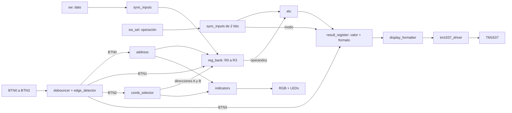
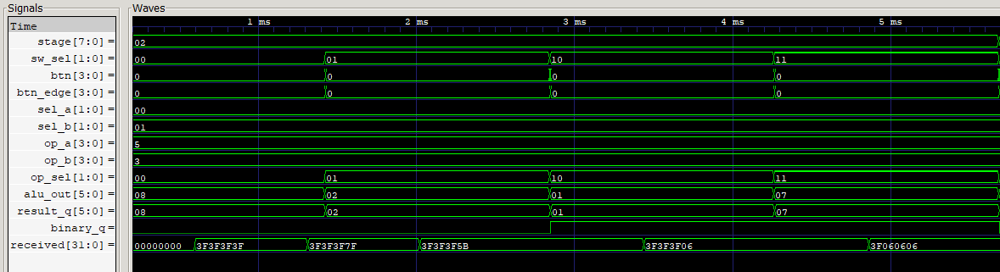
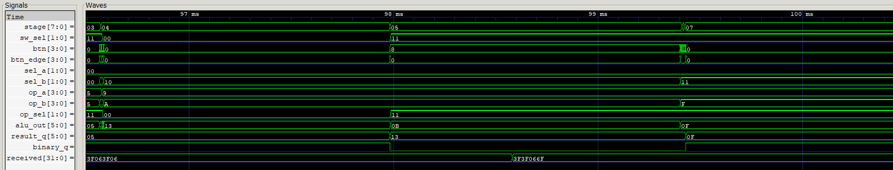

# Laboratorio 03 — ALU y banco de registros en Zybo Z7-10

Electrónica Digital II · Universidad Nacional de Colombia, sede Bogotá · 2026-2

| Integrante | Correo |
|---|---|
| Julián David Saavedra Pacheco | jusaavedrap@unal.edu.co |
| Juan Sebastián Cortés Gutiérrez | jcortesgu@unal.edu.co |
| Carlos Eduardo Matheus Quintero | cmatheus@unal.edu.co |

## Descripción del sistema

El proyecto integra una ALU de cuatro bits, un banco de cuatro registros, un selector de operandos y un display TM1637. Sigue la arquitectura modular de la guía **Lab03 – ALU + Banco de Registros + Diseño Modular**.

**El diseño ya fue implementado en la FPGA y presentado presencialmente al profesor.** Los cinco videos de [evidencias/](evidencias/) documentan la explicación general y las pruebas de suma, resta, AND y OR.

El código Verilog se encuentra en [src/](src/) y las asignaciones de pines en [constraints/zybo_z7.xdc](constraints/zybo_z7.xdc). Los testbenches verifican los módulos y generan trazas VCD para el análisis de señales. La prueba de antirrebote utiliza el umbral de 1.250.000 ciclos, equivalente a 10 ms con un reloj de 125 MHz.

## Funcionamiento e interfaz

1. `sw[3:0]` establece un dato de cuatro bits, entre 0 y 15.
2. BTN0 elige el registro de destino; BTN1 guarda el dato en él.
3. BTN2 cambia el par ordenado de registros que alimenta A y B.
4. Los dos switches externos `sw_sel[1:0]` seleccionan la operación.
5. BTN3 captura el resultado y el formato. El display conserva ambos hasta una nueva ejecución.

La ALU calcula continuamente, pero el display utiliza el **resultado almacenado**. Cambiar datos, operación o pareja de registros no modifica lo mostrado hasta pulsar BTN3. El refresco periódico del TM1637 transmite ese mismo contenido guardado.

| Señal o control | Función implementada |
|---|---|
| `clk` | Reloj de 125 MHz de la Zybo Z7 |
| `sw[3:0]` | Dato de entrada del banco de registros |
| `sw_sel[1:0]` | Operación, mediante switches externos independientes del dato |
| `btn[0]` / BTN0 | Avanza destino: R0 → R1 → R2 → R3 → R0 |
| `btn[1]` / BTN1 | Escribe en el destino seleccionado |
| `btn[2]` / BTN2 | Avanza la combinación ordenada A,B |
| `btn[3]` / BTN3 | Guarda resultado y formato |
| `led[3:0]` | `{sel_a,sel_b}`: dos bits para el índice de A y dos para B |
| `{rgb_r,rgb_g,rgb_b}` | Destino: R0 rojo `100`, R1 verde `010`, R2 azul `001`, R3 blanco `111` |
| `tm_clk`, `tm_dio` | Interfaz del TM1637; DIO bidireccional |

| `sw_sel[1:0]` | Operación | Ejemplo A=15, B=1 | Display |
|---|---|---|---|
| `00` | Suma `A+B` | 15+1=16 | `0016`, decimal |
| `01` | Resta `A−B` | 15−1=14 | `0014`, decimal |
| `10` | AND `A & B` | `1111 & 0001 = 0001` | `0001`, binario |
| `11` | OR `A \| B` | `1111 \| 0001 = 1111` | `1111`, binario |

Los operandos son **sin signo**, de cuatro bits. El resultado tiene **seis bits con signo**: suma de 0 a 30 y resta de −15 a 15. Así, 15+1 produce 16 sin recorte a cuatro bits. Invertir los operandos de la resta produce 1−15=−14, mostrado como `-014`.

La implementación presentada usa switches externos para la operación y LEDs que codifican los índices A/B. Se documentan estas convenciones del montaje, aunque la interfaz propuesta en la guía describe switches compartidos y LEDs por registro activo.

### Selección de operandos

El destino de escritura y la pareja de operandos son independientes. El RGB puede estar verde porque se escribe R1 mientras la ALU utiliza A=R0 y B=R1.

`comb_selector` incrementa un índice de cuatro bits, de 0 a 15, con cada pulsación de BTN2. `sel_a=índice[3:2]` y `sel_b=índice[1:0]`. El recorrido es:

```text
(R0,R0), (R0,R1), (R0,R2), (R0,R3),
(R1,R0), (R1,R1), (R1,R2), (R1,R3),
(R2,R0), (R2,R1), (R2,R2), (R2,R3),
(R3,R0), (R3,R1), (R3,R2), (R3,R3), y vuelve al inicio.
```

`LED3:LED2` representa el índice de A y `LED1:LED0` el de B. `0001` indica A=R0/B=R1; `0100`, A=R1/B=R0. `0000` significa A=B=R0.

## Arquitectura modular



`top.v` conecta los bloques anteriores. `display_tm1637.v` agrupa el formateador y el driver.

| Módulo | Funcionamiento |
|---|---|
| [top.v](src/top.v) | Integra entradas, controles, banco, ALU, resultado, indicadores y display. Mantiene separados los buses de datos y operación. |
| [sync_inputs.v](src/sync_inputs.v) | Sincroniza los switches mediante dos etapas por bit. Se instancia con anchos de cuatro y dos bits. |
| [debouncer.v](src/debouncer.v) | Sincroniza cada botón y exige `STABLE_CYCLES` muestras estables antes de aceptar un cambio al pulsar o soltar. |
| [edge_detector.v](src/edge_detector.v) | Genera un pulso de un ciclo en la subida del botón filtrado; mantenerlo presionado no repite acciones. |
| [address.v](src/address.v) | Contador de dos bits que avanza el destino de escritura con BTN0. |
| [reg_bank.v](src/reg_bank.v) | Cuatro palabras de cuatro bits. Escritura en flanco ascendente con `write_enable` y dos lecturas combinacionales independientes. |
| [comb_selector.v](src/comb_selector.v) | Contador de cuatro bits activado por BTN2; bits altos para A y bajos para B. |
| [alu.v](src/alu.v) | Calcula las cuatro operaciones de forma combinacional. Extiende los operandos antes de sumar/restar y entrega seis bits con signo. |
| [result_register.v](src/result_register.v) | Con `execute`, captura `alu_result` y `binary_mode`. Conserva `result_q` y `binary_q` entre ejecuciones. |
| [indicators.v](src/indicators.v) | Asigna el RGB según el destino y muestra `{sel_a,sel_b}` en los LEDs. |
| [display_tm1637.v](src/display_tm1637.v) | Une conversión a segmentos y transmisión serial; recibe valor y modo guardados. |
| [display_formatter.v](src/display_formatter.v) | Convierte el resultado en cuatro bytes de segmentos, en decimal con signo o cuatro bits binarios. |
| [tm1637_driver.v](src/tm1637_driver.v) | Captura los cuatro dígitos al iniciar la trama. Su máquina de estados envía comandos, datos LSB primero, ACK y brillo. |

### Reloj y captura

La FPGA usa `CLK_HZ=125_000_000`, `DEBOUNCE_CYCLES=1_250_000` y `TM_BIT_HZ=100_000`. El umbral de antirrebote equivale a 10 ms, más la sincronización. Todos los bloques secuenciales utilizan el mismo reloj; los botones generan habilitaciones.

Al configurar la tarjeta, los registros, la dirección, la combinación y el resultado parten de cero. El modo inicial es decimal. No hay entrada de reset adicional. Si dos acciones se aceptan en un mismo flanco, los registros consumen el estado anterior: escribir y ejecutar simultáneamente usa el operando previo. La interfaz normal se maneja pulsando un botón cada vez.

### Visualización

- **Suma/resta:** decimal con ceros a la izquierda: `0016`, `0014`, `0030`. El signo negativo ocupa la izquierda: `-014`, `-015`.
- **AND/OR:** cuatro bits, con el bit 3 a la izquierda: `0001`, `1111`. En OR, `1111` equivale a 15 decimal.
- BTN3 almacena el modo junto al valor; mover el selector sin ejecutar conserva ambos.

El driver transmite `0x40` (incremento automático), `0xC0` seguido de los cuatro bytes de segmentos y `0x8F` (display habilitado, brillo 7), con START/STOP y un noveno pulso para ACK por byte. DIO se conduce a cero o se libera en alta impedancia. Capturar juntos los cuatro bytes evita mezclar resultados durante una trama. `ack_err` es un diagnóstico interno sin pin de salida en `top`.

## Simulación reproducible

La siguiente tabla resume los testbenches, los archivos de simulación generados y los resultados obtenidos. Las entradas, el procesamiento, las salidas y el desarrollo de cada prueba se detallan en el [índice de simulaciones](sim/README.md).

| Testbench | Ejecutable / traza | Resultado | Descripción y capturas |
|---|---|---|---|
| [tb_alu.v](sim/alu/tb_alu.v) | `tb_alu.vvp` / `alu.vcd` | **PASS:** 1.024 casos: 4 operaciones × 16 valores de A × 16 de B. | [Ver análisis](sim/alu/README.md) |
| [tb_reg_bank.v](sim/reg_bank/tb_reg_bank.v) | `tb_reg_bank.vvp` / `reg_bank.vcd` | **PASS:** 64 escrituras y 1.040 pares de lectura; retención, aislamiento y escritura síncrona. | [Ver análisis](sim/reg_bank/README.md) |
| [tb_controls.v](sim/controls/tb_controls.v) | `tb_controls.vvp` / `controls.vcd` | **PASS:** dirección, 16 pares recorridos dos veces, indicadores y captura/retención de valor y formato. | [Ver análisis](sim/controls/README.md) |
| [tb_debouncer.v](sim/debouncer/tb_debouncer.v) | `tb_debouncer_real.vvp` / `debouncer_real.vcd` | **PASS:** N=1.250.000, el valor usado en la FPGA; rebotes, umbral de 10 ms, pulsación mantenida y nueva pulsación. | [Ver análisis](sim/debouncer/README.md) |
| [tb_display_formatter.v](sim/display_formatter/tb_display_formatter.v) | `tb_display_formatter.vvp` / `display_formatter.vcd` | **PASS:** 64 valores decimales con signo (−32…31) y 16 patrones binarios. | [Ver análisis](sim/display_formatter/README.md) |
| [tb_tm1637.v](sim/tm1637/tb_tm1637.v) | `tb_tm1637.vvp` / `tm1637.vcd` | **PASS:** siete tramas, comandos, bits, ACK/NACK, coherencia y recuperación. | [Ver análisis](sim/tm1637/README.md) |
| [tb_top.v](sim/top/tb_top.v) | `tb_top.vvp` / `top.vcd` | **PASS:** cuatro registros, 16 pares × 4 operaciones, **197 comprobaciones**, display serial y retención. | [Ver análisis](sim/top/README.md) |

La integración carga **R0=5, R1=3, R2=10 y R3=15** y usa un reloj simulado de 4 MHz y cuatro muestras de antirrebote. Son parámetros del testbench; los valores por defecto de FPGA se conservan. Las pruebas físicas emplean **R0=15 y R1=1**.

### Capturas de GTKWave

Las diez capturas de GTKWave se analizan en los README de [ALU](sim/alu/README.md#captura-y-análisis), [banco de registros](sim/reg_bank/README.md#captura-y-análisis), [controles](sim/controls/README.md#capturas-y-análisis), [antirrebote](sim/debouncer/README.md#captura-y-análisis), [formateador](sim/display_formatter/README.md#captura-y-análisis), [TM1637](sim/tm1637/README.md#captura-y-análisis) e [integración](sim/top/README.md#capturas-y-análisis).



La etapa 2 muestra A=5 y B=3 con resultados 8, 2, 1 y 7 para suma, resta, AND y OR. `binary_q` selecciona decimal para las operaciones aritméticas y binario para las lógicas; `received` confirma los segmentos transmitidos al display.



En la etapa 4 cambian datos, pareja y operación mientras el resultado guardado se conserva. En la etapa 5, `result_q` mantiene `13` hexadecimal (19 decimal) aunque `alu_out` pase a `0B` (11 decimal) con BTN3 mantenido. La siguiente ejecución de la etapa 7 guarda `0F` (15) y cambia al modo binario. Los rebotes de la etapa 6 quedan comprimidos y la etapa 8 queda fuera de esta ventana.


La captura del driver muestra la actualización de `received`, el avance de la trama 2 a la 3 y la desactivación temporal de ACK en la cuarta. El diagnóstico `ack_err` de ese NACK se actualiza después de la ventana mostrada. Cada análisis detalla qué eventos se ven y qué intervalos adicionales permitirían representar el resto de la prueba.

## Evidencias de funcionamiento en FPGA

En cada operación se cambiaron los **switches externos de selección**. El RGB identifica el destino de escritura: R0 rojo y R1 verde.

**Explicación general:** [video de aproximadamente 55 segundos](evidencias/explicacion_general.mp4), directamente en `evidencias/`.

| Prueba | Video | Descripción | Resultado |
|---|---|---|---|
| Suma, ≈16,6 s | [Video](evidencias/01_suma/video.mp4) | [Procedimiento](evidencias/01_suma/README.md) | 15+1=16 → `0016` |
| Resta, ≈28,1 s | [Video](evidencias/02_resta/video.mp4) | [Procedimiento](evidencias/02_resta/README.md) | 15−1=14 → `0014`; 1−15=−14 → `-014` |
| AND, ≈25,8 s | [Video](evidencias/03_and/video.mp4) | [Procedimiento](evidencias/03_and/README.md) | `1111 & 0001 = 0001` |
| OR, ≈23,3 s | [Video](evidencias/04_or/video.mp4) | [Procedimiento](evidencias/04_or/README.md) | `1111 \| 0001 = 1111` |

## Análisis de resultados

La suma física 15+1=16 utiliza el ancho adicional del resultado. Las dos restas comprueban el orden A/B y la representación negativa. AND conserva el único bit común en uno; OR conserva todos los bits activos de cualquiera de los operandos. El formato decimal o binario permite interpretar cada resultado en el display.

La prueba exhaustiva de la ALU complementa las cuatro demostraciones físicas. Banco y controles se verifican por separado; la integración comprueba escritura, selección, ejecución y transmisión al display. Guardar valor y modo garantiza la conservación del último resultado hasta una nueva ejecución.

## Conclusiones

1. La separación en módulos permite verificar por partes el cálculo, el almacenamiento, los controles, el formato y la transmisión. La prueba integrada comprueba su interacción mediante la carga de los cuatro registros, las 16 parejas de operandos y las cuatro operaciones.
2. El resultado de seis bits con signo conserva sumas mayores que 15 y restas negativas. Las demostraciones físicas de 15+1=16 y de 15−1=14 frente a 1−15=−14 concuerdan con la codificación y el rango implementados.
3. Guardar conjuntamente el resultado y su formato evita que cambios posteriores en los operandos o en la operación modifiquen el display. La captura de retención muestra esa separación entre `alu_out` y `result_q`, y el ensayo con BTN3 mantenido comprueba la ejecución única por pulsación aceptada.
4. La captura independiente de antirrebote relaciona una pulsación sostenida con su aceptación después de 10 ms. El formateador convierte el resultado a códigos de segmentos y el driver introduce la latencia de transmisión esperada; por ello el valor guardado y el patrón recibido no tienen que cambiar en el mismo instante.
5. Los siete testbenches verificados aportan la cobertura completa declarada en la tabla. Las diez capturas documentan ventanas concretas: algunas requieren otras vistas para mostrar todas las operaciones, los destinos de escritura, los negativos o las recuperaciones de ACK. Esta distinción permite interpretar la evidencia visual sin atribuirle eventos que quedan fuera de sus intervalos.
