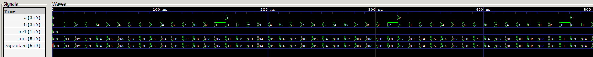

# Simulación de la ALU

## Qué se prueba

[tb_alu.v](tb_alu.v) verifica [alu.v](../../src/alu.v), el bloque que transforma dos operandos de cuatro bits en un resultado aritmético o lógico. La prueba recorre las cuatro operaciones y todos los valores posibles de ambos operandos: **4 × 16 × 16 = 1.024 casos**.

Esta carpeta contiene el [testbench](tb_alu.v), el [ejecutable](tb_alu.vvp) y la [traza de señales](alu.vcd).

## Entradas y salida del módulo

| Puerto | Dirección y ancho | Interpretación |
|---|---|---|
| `a` | Entrada, 4 bits | Operando A sin signo: `0000` a `1111`, es decir, 0 a 15 |
| `b` | Entrada, 4 bits | Operando B sin signo, con la misma codificación |
| `sel` | Entrada, 2 bits | Selección de la operación |
| `out` | Salida, 6 bits con signo | Resultado en complemento a dos; puede representar resultados negativos de la resta |

La ALU no recibe reloj ni señal de ejecución. Su salida se calcula a partir de las entradas actuales. El almacenamiento y la ejecución con BTN3 se verifican en [controles](../controls/README.md) e [integración](../top/README.md).

## Codificación y procesamiento

| `sel` | Procesamiento | Rango de resultado | Ejemplo A=15, B=1 |
|---|---|---|---|
| `00` | Suma A+B | 0 a 30 | 16, `010000` en seis bits |
| `01` | Resta A−B | −15 a 15 | 14, `001110` en seis bits |
| `10` | AND bit a bit | 0 a 15 | `1111 AND 0001 = 0001` |
| `11` | OR bit a bit | 0 a 15 | `1111 OR 0001 = 1111` |

Para sumar o restar, el módulo antepone dos ceros a cada operando y los trata como números de seis bits con signo. Así conserva que las entradas son positivas y dispone de ancho suficiente para el resultado: 15+15=30 no se recorta a cuatro bits. En AND y OR se procesan las cuatro posiciones de los operandos y el resultado se entrega en el bus de seis bits.

El signo pertenece al resultado, no a los operandos. Por ejemplo, con A=1 y B=15 la resta vale −14; su codificación de seis bits es `110010`. Para leerla como −14 en GTKWave debe interpretarse el bus como decimal con signo; como entero sin signo ese mismo patrón representa 50.

## Cómo funciona el testbench

1. Inicializa `a`, `b` y `sel` en cero. Después de 1 ns comprueba que `out` ya vale cero, incluso sin haber cambiado las entradas.
2. El índice `k` selecciona una operación; dentro de ella, `i` recorre A de 0 a 15 y `j` recorre B de 0 a 15.
3. Para cada combinación asigna `a=i`, `b=j` y `sel=k` y calcula `expected` mediante las operaciones aritméticas o lógicas del testbench.
4. Espera 10 ns y compara `out` con `expected`. La comparación `!==` también detecta bits desconocidos o de alta impedancia.
5. Incrementa `checks` por cada caso correcto y finaliza cuando se han recorrido los 1.024 casos.

La espera de 10 ns separa los estímulos y permite observar cada respuesta combinacional. No representa un período de reloj de la ALU. La traza completa termina en **10.241 ns**, equivalentes a **10,241 µs**.

## Señales para interpretar el VCD

| Señales de `tb_alu` | Qué permiten relacionar |
|---|---|
| `a`, `b`, `sel` | Entradas de cada caso y operación seleccionada |
| `out`, `expected` | Coincidencia entre el resultado del módulo y la referencia |
| `checks` | Cantidad de casos completados |
| `i`, `j`, `k` | Posición dentro de los recorridos de operandos y operación |

Un cambio de entradas produce el resultado correspondiente sin esperar un flanco de reloj. Al pasar de suma a resta aparecen valores negativos; en AND y OR los dos bits altos del resultado permanecen en cero. El VCD también incluye las señales de la instancia `dut`.

## Captura y análisis

La captura muestra los operandos `a[3:0]` y `b[3:0]`, el selector `sel[1:0]`, la salida `out[5:0]` y la referencia `expected[5:0]`. La ventana comprende aproximadamente los primeros **500 ns** y mantiene `sel=00`, por lo que muestra la **suma**.

`b` recorre los valores hexadecimales `0` a `F` y después vuelve a cero mientras `a` avanza. Las filas `out` y `expected` coinciden en los casos visibles. Cuando A=0, la salida reproduce B; con A=1 y B=`F`, el resultado es `10` hexadecimal, equivalente a **16 decimal**. Ese resultado muestra que la salida conserva el acarreo en su ancho de seis bits.

Los operandos y resultados están visualizados en hexadecimal. Por ejemplo, `A` equivale a 10 decimal y `10` equivale a 16 decimal.

### Operaciones en la secuencia completa

La imagen representa el comienzo del recorrido de suma, con variación de los operandos y coincidencia entre `out` y `expected`. Las otras operaciones se desarrollan en intervalos posteriores del mismo VCD: resta desde **2,561 µs**, AND desde **5,121 µs** y OR desde **7,681 µs**. En el intervalo de resta aparecen los resultados negativos en complemento a dos. La secuencia completa termina en **10,241 µs**.

La ejecución completa verifica los **1.024 casos** de las cuatro operaciones. La figura ilustra la respuesta combinacional y la comparación automática durante el intervalo de suma.

[Índice de simulaciones](../README.md) · [Resumen del proyecto](../../README.md).
