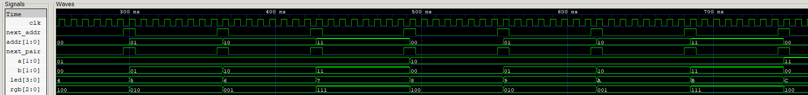
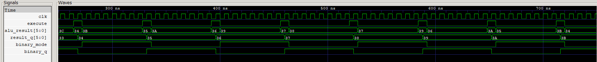

# Simulación de controles, indicadores y registro de resultado

## Qué se prueba

[tb_controls.v](tb_controls.v) reúne cuatro módulos: [address.v](../../src/address.v), [comb_selector.v](../../src/comb_selector.v), [result_register.v](../../src/result_register.v) e [indicators.v](../../src/indicators.v). Verifica el recorrido de direcciones y parejas, la codificación de los indicadores y la conservación del resultado y de su formato.

Archivos: [testbench](tb_controls.v), [ejecutable](tb_controls.vvp) y [traza VCD](controls.vcd).

Esta prueba aplica directamente señales de habilitación de un ciclo. El filtrado de botones y el cálculo de la ALU se prueban en otros testbenches.

## `address`: destino de escritura

| Puerto | Dirección y ancho | Señal del testbench |
|---|---|---|
| `clk` | Entrada, 1 bit | `clk`, reloj de 125 MHz |
| `btn0_rising_edge` | Entrada, 1 bit | `next_addr`, habilitación para avanzar |
| `address` | Salida, 2 bits | `addr`, índice del destino de escritura |

La instancia `u1` contiene un contador inicializado en cero. En una subida de reloj con `next_addr=1`, suma uno. Al tener dos bits, el recorrido es `00 → 01 → 10 → 11 → 00`, correspondiente a R0, R1, R2, R3 y nuevamente R0. Sin habilitación conserva la dirección.

## `comb_selector`: pareja ordenada de operandos

| Puerto | Dirección y ancho | Señal del testbench |
|---|---|---|
| `clk` | Entrada, 1 bit | `clk` |
| `btn2_rising_edge` | Entrada, 1 bit | `next_pair` |
| `sel_a` | Salida, 2 bits | `a`, índice del registro para el operando A |
| `sel_b` | Salida, 2 bits | `b`, índice del registro para el operando B |

La instancia `u2` incrementa un contador de cuatro bits con `next_pair`. Los bits `[3:2]` forman `a` y los bits `[1:0]` forman `b`. Se recorren las 16 parejas `(R0,R0), (R0,R1), …, (R3,R3)` y se vuelve al inicio. B cambia en cada avance y A cambia cuando B vuelve de 3 a 0.

Aquí `a` y `b` son **direcciones de dos bits**, no los valores de cuatro bits que la ALU recibiría al leer los registros.

## `result_register`: almacenamiento de valor y formato

| Puerto | Dirección y ancho | Significado |
|---|---|---|
| `clk` | Entrada, 1 bit | Reloj común |
| `execute` | Entrada, 1 bit | Autoriza la captura en una subida de reloj |
| `alu_result` | Entrada, 6 bits con signo | Valor que se desea guardar |
| `binary_mode` | Entrada, 1 bit | Formato solicitado: cero decimal, uno binario |
| `result_q` | Salida, 6 bits con signo | Último valor capturado |
| `binary_q` | Salida, 1 bit | Formato capturado junto al valor |

La instancia `u3` inicializa ambas salidas en cero. Con `execute=1` guarda valor y formato en el mismo flanco. Con `execute=0` conserva ambos, aunque cambien sus entradas. Esto evita que el resultado de una operación ya ejecutada cambie de representación al mover el selector externo.

## `indicators`: LEDs y RGB

| Entradas | Procesamiento | Salidas |
|---|---|---|
| `wr_addr[1:0]`, conectado a `addr` | Decodificación combinacional del destino | `rgb[2:0]`, en orden `{R,G,B}` |
| `sel_a[1:0]`, `sel_b[1:0]`, conectados a `a,b` | Concatenación de las dos direcciones | `led[3:0]={a,b}` |

La instancia `u4` asigna R0→rojo `100`, R1→verde `010`, R2→azul `001` y R3→blanco `111`. Los LEDs codifican índices: `0001` significa A=R0/B=R1 y `0100`, A=R1/B=R0. No muestran el resultado numérico de la ALU.

## Cómo funciona la simulación

El reloj tiene un período de **8 ns**. Primero se comprueba el estado inicial de dirección, pareja y resultado. Después se realizan **32 iteraciones**, que equivalen a dos recorridos completos de las 16 parejas.

En la iteración `i`, la prueba comprueba `addr=i mod 4`, `{a,b}=i mod 16`, el código de LEDs y el RGB esperado. A continuación establece `alu_result=i−16`, `binary_mode=i mod 2` y activa `execute` durante un ciclo. En el siguiente flanco descendente compara el valor y el modo guardados con los esperados.

Después desactiva la ejecución, invierte el modo y cambia el dato de entrada. Espera tres ciclos y comprueba que ambas salidas sigan guardando la captura anterior. Finalmente activa `next_addr` y `next_pair` durante un ciclo y deja avanzar la siguiente iteración.

Los valores capturados van de **−16 a 15**. El −16 verifica la capacidad del registro de seis bits y no se presenta como resultado alcanzable por la resta de dos operandos de cuatro bits, cuyo mínimo es −15. La traza completa termina en **2.048 ns**, equivalentes a **2,048 µs**.

## Señales para interpretar el VCD

- `clk`, `next_addr`, `addr`: avance de la dirección exclusivamente con habilitación.
- `next_pair`, `a`, `b` y `u2.comb_reg`: recorrido de las parejas y retorno de 15 a 0.
- `addr`, `rgb`, `a`, `b`, `led`: correspondencia entre selección e indicadores.
- `execute`, `alu_result`, `result_q`: captura del valor y conservación al desactivar la ejecución.
- `binary_mode`, `binary_q`: captura y retención del formato de manera independiente de cambios posteriores en la entrada.

Para leer los números negativos, `alu_result` y `result_q` se interpretan como valores con signo de seis bits. Las direcciones y los indicadores se interpretan como índices o patrones binarios.

## Capturas y análisis

### Selección de direcciones, parejas e indicadores

**Imagen 1 suministrada por el equipo.** Las entradas `next_addr` y `next_pair` y las salidas `addr`, `a`, `b`, `led` y `rgb` identifican la parte de selección de `tb_controls`. La ventana, de unos **250–760 ns**, contiene varios pulsos y permite distinguir sus efectos.

Con cada habilitación y la siguiente subida de reloj, `addr` avanza por `00`, `01`, `10` y `11`. El RGB sigue esa dirección: `100` rojo, `010` verde, `001` azul y `111` blanco. El retorno a `00` restablece el rojo.

La pareja avanza con B como índice rápido. Al pasar de `a=01,b=11` a `a=10,b=00`, B vuelve a cero y A aumenta. Los LEDs recorren `4,5,6,7,8,9,A,B,C`, mostrados en **hexadecimal**: el `8`, por ejemplo, equivale al patrón binario `1000`, que codifica A=R2 y B=R0. Los LEDs representan la concatenación de índices, no una salida de la ALU.

### Captura y retención de valor y formato

**Imagen 2 suministrada por el equipo.** `execute`, `alu_result`, `result_q`, `binary_mode` y `binary_q` corresponden al registro de resultado de la misma simulación. En este intervalo se repiten varias capturas de un ciclo y cambios de entradas sin ejecución.

Por ejemplo, `alu_result=34` hexadecimal se captura en `result_q` alrededor de **268 ns**. Después la entrada pasa a `3B`, pero el resultado permanece en `34` hasta la siguiente ejecución. Lo mismo ocurre con el formato: `binary_mode` puede cambiar mientras `binary_q` conserva el último modo capturado. Al activarse `execute`, valor y formato se actualizan juntos.

Los buses de seis bits están en hexadecimal y contienen números con signo: `34` representa **−12** y `3B` representa **−5**, porque ambos patrones usan complemento a dos. Las cifras de la captura no deben leerse como enteros decimales positivos.

### Alcance de las vistas

Las dos ventanas son suficientes para explicar varios avances de los selectores, un retorno de dirección y varios ejemplos de captura y retención. No hace falta ampliar su duración para apreciar esos mecanismos. La ejecución completa recorre las 16 parejas dos veces y también verifica los indicadores y el almacenamiento del formato.

[Índice de simulaciones](../README.md) · [Resumen del proyecto](../../README.md).
