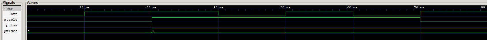

# Simulación del antirrebote con el umbral real

## Qué se prueba

[tb_debouncer.v](tb_debouncer.v) conecta [debouncer.v](../../src/debouncer.v) con [edge_detector.v](../../src/edge_detector.v). Comprueba que una pulsación de duración suficiente genere una sola acción, que los cambios breves se rechacen y que sea necesario soltar correctamente el botón para aceptar otra pulsación.

Se utiliza **N=1.250.000**, el umbral empleado en la FPGA, con un reloj de **125 MHz**. Archivos: [testbench](tb_debouncer.v), [ejecutable](tb_debouncer_real.vvp) y [traza VCD](debouncer_real.vcd).

## Entradas, procesamiento y salidas

### Filtro `debouncer`

| Puerto o parámetro | Tipo | Función en esta prueba |
|---|---|---|
| `clk` | Entrada, 1 bit | Reloj de período 8 ns, generado cambiando el nivel cada 4 ns |
| `btn_in` | Entrada, 1 bit | Conectado a `btn`, el botón simulado; cero suelto y uno pulsado |
| `STABLE_CYCLES` | Parámetro entero | 1.250.000 muestras consecutivas para aceptar un nivel nuevo |
| `btn_out` | Salida, 1 bit | Conectado a `stable`, el nivel del botón ya filtrado |

La entrada pasa por dos flip-flops de sincronización, `btn_sync_0` y `btn_sync_1`. El filtro compara la segunda etapa con el valor aceptado en `btn_out`:

- Si coinciden, reinicia el contador porque no hay un cambio pendiente.
- Si difieren, cuenta las muestras consecutivas del nivel nuevo.
- Al alcanzar `N−1`, acepta la muestra que completa N ciclos, actualiza `btn_out` y reinicia la cuenta.

Si el nivel vuelve al valor aceptado antes de completar el umbral, la cuenta se pierde y la salida se conserva. El mismo procedimiento filtra tanto la pulsación como la liberación. El contador necesita **21 bits** para este valor de N.

El umbral es `1.250.000 × 8 ns = 10 ms`. Entre el cambio de la entrada externa y la aceptación también interviene la sincronización. La simulación comprueba la secuencia digital; no reproduce el fenómeno analógico de metastabilidad.

### Detector `edge_detector`

| Puerto | Dirección | Conexión y función |
|---|---|---|
| `clk` | Entrada | El mismo reloj de 125 MHz |
| `sig_in` | Entrada | `stable`, salida del filtro |
| `out` | Salida | `pulse`, habilitación de un ciclo en cada subida de `stable` |

El detector recuerda el nivel anterior en `sig_prev` y calcula `out=sig_in & ~sig_prev`. Cuando el nivel filtrado sube, la salida vale uno hasta que el siguiente flanco actualiza ese recuerdo. Por eso `pulse` dura un ciclo, **8 ns**, aunque `stable` permanezca en uno durante mucho más tiempo.

## Desarrollo del testbench

Un contador auxiliar llamado `pulses` incrementa en cada subida de reloj que encuentra `pulse=1`. Pertenece a la verificación y no es una salida del circuito de FPGA.

| Etapa | Estímulo aplicado a `btn` | Comprobación |
|---|---|---|
| Estado inicial | Botón en cero durante cinco ciclos | `stable=0`, `pulse=0` |
| Cambio insuficiente al pulsar | Uno durante N−1 ciclos y regreso a cero | No debe contarse ninguna pulsación |
| Pulsación válida | Uno durante N+2 ciclos y comprobación del umbral | `stable` ya es uno; después se comprueba que el pulso se cuente una sola vez |
| Botón mantenido | Se conserva el uno durante más ciclos | `pulses` permanece en 1 |
| Cambio insuficiente al soltar | Cero durante N−1 ciclos y regreso a uno | `stable` permanece en uno y no se rearma una nueva pulsación |
| Liberación válida | Cero durante N+4 ciclos | `stable` vuelve a cero y `pulses` sigue en 1 |
| Segunda pulsación | Uno durante N+4 ciclos | `pulses` llega a 2 |

El cambio insuficiente dura **9,999992 ms**, apenas un ciclo por debajo del umbral, lo que verifica su límite. El testbench también comprueba por separado el instante de aceptación del nivel y el ciclo posterior en que se contabiliza el pulso. La traza termina en **80,000216 ms** de tiempo simulado.

## Qué contiene el VCD

| Señal de `tb_debouncer` | Qué muestra |
|---|---|
| `btn` | Todos los cambios del botón, incluidos los rechazados |
| `stable` | Cambios aceptados después del filtrado |
| `pulse` | Pulsos de un ciclo asociados a subidas válidas de `stable` |
| `pulses` | Cuenta de acciones aceptadas, que finaliza en 2 |

El VCD guarda estas cuatro señales. El reloj rápido, las etapas de sincronización y el contador interno no se incluyeron en el volcado para mantener la traza pequeña. Una vista de todo el ensayo permite ver los intervalos de 10 ms; para distinguir los pulsos de 8 ns hará falta una ampliación alrededor de las subidas de `stable`.

## Captura y análisis

**Imagen 5 suministrada por el equipo.** Las cuatro señales `btn`, `stable`, `pulse` y `pulses` identifican la prueba independiente de antirrebote. La vista abarca varias decenas de milisegundos y llega aproximadamente a **80 ms**.

La pulsación que comienza alrededor de **20 ms** se acepta cerca de **30 ms**, de acuerdo con el umbral de 10 ms. En ese momento aumenta `stable` y la cuenta `pulses` pasa de 0 a 1. Mantener el botón pulsado no produce más incrementos. El intento de liberación entre aproximadamente 40 y 50 ms no alcanza el umbral; la liberación posterior sí prepara el circuito para otra pulsación.

La separación entre el cambio solicitado por `btn` y el nivel aceptado permite observar el filtrado en esta escala. Sin embargo, el pulso de ejecución dura solo **8 ns**, por lo que queda comprimido en una vista de decenas de milisegundos.

### Alcance y ampliaciones útiles

El cambio inicial que el filtro rechaza, entre 0 y 10 ms, queda fuera del comienzo de esta ventana. Además, la segunda pulsación se acepta apenas después de **80 ms**: `stable` sube en **80,000196 ms** y `pulses` llega a 2 en **80,000204 ms**. La imagen no permite leer ese último incremento en su extremo derecho; no significa que falte en el VCD.

Una vista general desde cero y una ampliación de **79,999 a 80,000216 ms** permitirían mostrar el último pulso y la cuenta final. Para el primer pulso puede ampliarse alrededor de **30,000076–30,000084 ms**. El intervalo completo de la prueba termina en **80,000216 ms**, con dos pulsaciones aceptadas.

[Índice de simulaciones](../README.md) · [Resumen del proyecto](../../README.md).
