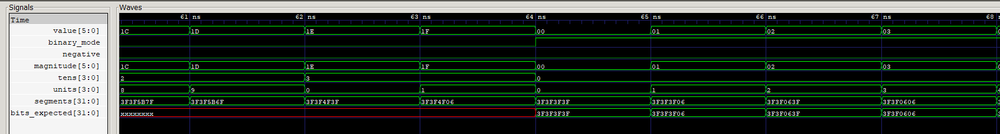

# Simulación del formateador del display

## Qué se prueba

[tb_display_formatter.v](tb_display_formatter.v) verifica [display_formatter.v](../../src/display_formatter.v), encargado de convertir un resultado numérico en los cuatro bytes de segmentos que necesita el display. Se comprueban **64 valores decimales con signo** y **16 patrones binarios**.

Archivos: [testbench](tb_display_formatter.v), [ejecutable](tb_display_formatter.vvp) y [traza VCD](display_formatter.vcd).

El formateador produce códigos de segmentos. El envío de esos códigos por CLK/DIO se verifica en la [prueba del driver](../tm1637/README.md).

## Entradas y salida

| Puerto | Dirección y ancho | Interpretación |
|---|---|---|
| `result` | Entrada, 6 bits con signo | Número en complemento a dos; se conecta a `value` en el testbench |
| `binary_mode` | Entrada, 1 bit | Cero selecciona decimal con signo; uno selecciona cuatro bits binarios |
| `segments` | Salida, 32 bits | Cuatro códigos de ocho bits, uno por dígito |

El byte `[31:24]` corresponde al dígito izquierdo; `[23:16]` y `[15:8]` a los intermedios; `[7:0]` al derecho. El módulo es combinacional: no recibe reloj ni almacena el resultado.

## Codificación de segmentos

Cada byte activa los segmentos mediante los bits `0=a`, `1=b`, `2=c`, `3=d`, `4=e`, `5=f` y `6=g`; el bit 7 corresponde al punto decimal y permanece apagado en los códigos usados.

| Carácter | Código hexadecimal | Carácter | Código hexadecimal |
|---|---|---|---|
| 0 | `3F` | 5 | `6D` |
| 1 | `06` | 6 | `7D` |
| 2 | `5B` | 7 | `07` |
| 3 | `4F` | 8 | `7F` |
| 4 | `66` | 9 | `6F` |
| Signo menos | `40` | | |

Así, `32'h3F3F065B` es una secuencia de cuatro códigos que dibuja **0012**. No es el número 12 expresado directamente como un entero de 32 bits.

## Procesamiento en decimal

Con `binary_mode=0`, el bit 5 de `result` determina si el número es negativo. Si lo es, se calcula su magnitud mediante complemento a dos; en caso contrario se conserva el valor. Luego se determina la cifra de decenas comparando la magnitud con 10, 20 y 30, y se obtiene la unidad restando diez veces las decenas.

La salida se forma con signo o cero en la primera posición, un cero fijo en la segunda, decenas en la tercera y unidades en la cuarta. El rango completo de la entrada es **−32 a 31**: −32 se representa como `-032` y 31 como `0031`. Esta cobertura incluye valores más amplios que el rango de la ALU, −15 a 30.

## Procesamiento en binario

Con `binary_mode=1`, cada uno de los cuatro bits bajos de `result` se transforma en el código del carácter 0 (`3F`) o del carácter 1 (`06`). El bit 3 ocupa el dígito izquierdo y el bit 0 el derecho. No se realiza una conversión a cuatro cifras decimales.

| `value` | Modo | Caracteres mostrados | `segments` esperado |
|---|---|---|---|
| −14 | Decimal | `-014` | `403F0666` |
| 16 | Decimal | `0016` | `3F3F067D` |
| 30 | Decimal | `0030` | `3F3F4F3F` |
| 1 | Binario | `0001` | `3F3F3F06` |
| 15 | Binario | `1111` | `06060606` |

## Desarrollo del testbench

Primero se mantiene `binary_mode=0`. Un recorrido asigna a `value` los números −32 a 31. Después de cada asignación espera **1 ns** y compara `segments` con una tabla de 64 patrones esperados preparada en el testbench.

Luego activa `binary_mode=1` y recorre los valores de 0 a 15. Para cada uno construye `bits_expected`: el bit de cada posición determina si su byte debe ser `06` o `3F`. Tras 1 ns compara ese patrón con la salida del módulo.

Las comparaciones usan `!==` para detectar también valores desconocidos. En total se revisan **80 casos**, y la traza termina en **80 ns**. La espera entre casos facilita observar las respuestas combinacionales y no representa un reloj del módulo.

## Señales para interpretar el VCD

| Señales | Comportamiento representado |
|---|---|
| `value`, `binary_mode`, `segments` | Valor de entrada, representación seleccionada y cuatro códigos resultantes |
| `dut.negative`, `dut.magnitude` | Separación entre signo y magnitud durante la prueba decimal |
| `dut.tens`, `dut.units` | Obtención de las cifras decimales |
| `bits_expected` | Referencia de la segunda parte, cuando el modo es binario |

`value` se interpreta como decimal con signo y `segments` como hexadecimal de ocho cifras, separándolo en cuatro bytes. La tabla de patrones decimales es un arreglo del testbench; no se incluye como una señal única en el VCD.

## Captura y análisis

La captura relaciona el valor `value` y el modo `binary_mode` con el signo `negative`, la magnitud `magnitude`, las cifras `tens/units` y los patrones `segments/bits_expected`. La ventana muestra aproximadamente **60–68 ns**, alrededor del cambio de representación.

Antes de 64 ns, `binary_mode=0`. Los valores `1C`, `1D`, `1E` y `1F` están mostrados en hexadecimal y corresponden a **28, 29, 30 y 31**. `negative` permanece en cero; `magnitude` conserva el valor positivo; las decenas pasan de 2 a 3 y las unidades recorren 8, 9, 0 y 1. Los patrones de segmentos representan `0028`, `0029`, `0030` y `0031`.

En **64 ns**, `binary_mode` sube a uno y `value` vuelve a cero. La salida pasa a codificar bits individuales: para los valores 0, 1, 2 y 3 se obtienen los caracteres `0000`, `0001`, `0010` y `0011`. En este tramo, `segments` coincide con `bits_expected`.

La fila roja de `bits_expected` antes de 64 ns corresponde a una referencia auxiliar del testbench que todavía no se ha inicializado: solo se utiliza al comenzar las comprobaciones binarias. La salida `segments` ya tiene valores definidos, por lo que esos `X` de la referencia auxiliar no indican un fallo del formateador.

### Valores en la secuencia completa

La figura muestra los últimos valores positivos del recorrido decimal, el cambio de `binary_mode` y los primeros patrones binarios. Los valores decimales negativos se verifican durante los primeros **32 ns** de la simulación; los no negativos continúan hasta **64 ns**. El intervalo de **64–80 ns** recorre los 16 patrones binarios. Todos estos casos pertenecen a la misma secuencia de entrada y comparación de segmentos.

La verificación completa cubre los **64 valores decimales con signo y los 16 patrones binarios**. La imagen documenta la transición entre las dos representaciones y la coincidencia de `segments` con la referencia binaria.

[Índice de simulaciones](../README.md) · [Resumen del proyecto](../../README.md).
