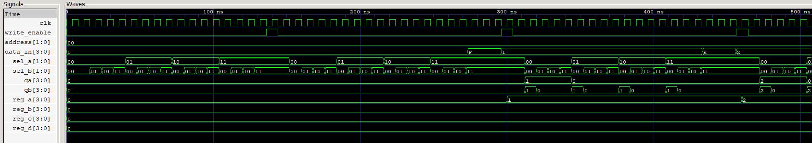

# Simulación del banco de registros

## Qué se prueba

[tb_reg_bank.v](tb_reg_bank.v) verifica [reg_bank.v](../../src/reg_bank.v): cuatro registros independientes, cada uno de cuatro bits, con un puerto de escritura y dos puertos de lectura. Comprueba que los datos se escriban en el registro correcto, se conserven cuando no hay habilitación y puedan consultarse por ambas salidas.

Archivos: [testbench](tb_reg_bank.v), [ejecutable](tb_reg_bank.vvp) y [traza VCD](reg_bank.vcd).

## Entradas y salidas

| Puerto | Dirección y ancho | Función |
|---|---|---|
| `clk` | Entrada, 1 bit | Reloj; la escritura ocurre en el flanco ascendente |
| `data_in` | Entrada, 4 bits | Dato sin signo, entre 0 y 15 |
| `address` | Entrada, 2 bits | Dirección del registro que se va a escribir |
| `write_enable` | Entrada, 1 bit | En uno permite escribir en el siguiente flanco ascendente |
| `sel_a` | Entrada, 2 bits | Dirección del registro leído por el puerto A |
| `sel_b` | Entrada, 2 bits | Dirección del registro leído por el puerto B |
| `reg_a_out` | Salida, 4 bits | Contenido del registro seleccionado por `sel_a`; se llama `qa` en el testbench |
| `reg_b_out` | Salida, 4 bits | Contenido del registro seleccionado por `sel_b`; se llama `qb` en el testbench |

La dirección de escritura y las dos direcciones de lectura son independientes. Los puertos A y B pueden consultar registros diferentes o el mismo registro.

## Direcciones y almacenamiento

| Dirección | Registro del sistema | Nombre interno en `reg_bank.v` |
|---|---|---|
| `00` | R0 | `reg_a` |
| `01` | R1 | `reg_b` |
| `10` | R2 | `reg_c` |
| `11` | R3 | `reg_d` |

Los cuatro registros se inicializan en cero. En cada subida de `clk`, si `write_enable=1`, un `case` sobre `address` actualiza únicamente el registro de destino con `data_in`. Si la habilitación está en cero, todos conservan su contenido.

Las lecturas son combinacionales: dos selecciones independientes conectan el registro pedido a cada salida. Cambiar `sel_a` o `sel_b` no escribe ni altera datos. Por ejemplo, si R0=15 y R1=1, seleccionar `sel_a=00` y `sel_b=01` entrega `qa=1111` y `qb=0001`.

El nombre interno `reg_a` identifica R0. En cambio, `reg_a_out` identifica el puerto de lectura A, que puede mostrar cualquiera de los cuatro registros.

## Desarrollo de la simulación

El reloj cambia cada 4 ns: período de **8 ns**, equivalente a **125 MHz**. Los estímulos se aplican en flancos descendentes, separados del flanco ascendente de escritura.

1. Un arreglo de referencia comienza con cuatro ceros. La tarea `verify_reads` recorre las 16 parejas `sel_a,sel_b` y compara ambas salidas con ese arreglo.
2. Dos recorridos anidados seleccionan cada una de las cuatro direcciones y cada dato entre 0 y 15: **64 escrituras** en total.
3. En cada escritura se fijan dirección, dato y habilitación en un flanco descendente. Un nanosegundo después se comprueba que los datos leídos todavía correspondan al estado previo, antes de la siguiente subida de reloj.
4. Al llegar al siguiente flanco descendente ya ocurrió la escritura. Se desactiva `write_enable`, se actualiza la referencia y se vuelven a revisar las 16 parejas de lectura.
5. Se cambia `data_in` manteniendo la habilitación en cero, se esperan dos ciclos y se comprueba que las salidas sigan correspondiendo al contenido almacenado.

El primer recorrido aporta 16 comprobaciones de parejas y los recorridos posteriores aportan 64×16: **1.040 pares de lectura**. La comparación revisa simultáneamente los dos puertos. La traza termina en **10.368 ns**, equivalentes a **10,368 µs**.

## Señales para interpretar el VCD

| Señales | Interpretación |
|---|---|
| `clk`, `write_enable`, `address`, `data_in` | Cuándo se autoriza una escritura, en qué dirección y con qué dato |
| `sel_a`, `sel_b`, `qa`, `qb` | Relación entre cada dirección de lectura y el dato entregado |
| `dut.reg_a` a `dut.reg_d` | Contenido de R0 a R3, útil para observar que solo cambia el destino escrito |
| `checks` | Avance del recorrido de las parejas de lectura |

La escritura se identifica por el cambio del registro de destino en una subida de `clk` con `write_enable=1`. Las direcciones A y B seleccionan los datos de lectura de forma independiente. La retención se comprueba cuando `data_in` cambia con `write_enable=0` y el contenido almacenado permanece constante.

## Captura y análisis

La captura relaciona la habilitación `write_enable`, la dirección `address` y el dato `data_in` con los registros almacenados y las lecturas seleccionadas mediante `sel_a/sel_b` en `qa/qb`. La ventana muestra aproximadamente **0–500 ns** y mantiene `address=00`, de modo que las escrituras visibles se dirigen a **R0**, llamado `reg_a` en el módulo.

El primer pulso escribe cero sobre el estado inicial cero, por lo que no produce un cambio numérico visible. Después se observa que `reg_a` pasa a **1 cerca de 300 ns** y a **2 cerca de 460 ns**, coincidiendo con subidas del reloj mientras la habilitación está activa. `reg_b`, `reg_c` y `reg_d` permanecen en cero.

Entre escrituras, `data_in` toma otros valores, como `F` y `E`, mientras `write_enable=0`; el dato almacenado se conserva. Los recorridos de `sel_a` y `sel_b` hacen que `qa` y `qb` entreguen el contenido del registro solicitado. Tras guardar R0=1, leer la dirección `00` produce 1 y leer los otros registros produce cero. La selección de cada puerto es independiente.

### Recorrido de las direcciones

El intervalo representado muestra las primeras escrituras y lecturas de R0. El mismo procedimiento se aplica a los demás registros en intervalos posteriores: R1 desde **2,696 µs**, R2 desde **5,256 µs** y R3 desde **7,816 µs**. En cada dirección se recorren los 16 datos posibles y se comprueban ambos puertos de lectura. El recorrido de los cuatro destinos termina en **10,368 µs**.

La prueba completa verificada incluye **64 escrituras y 1.040 pares de lectura**. Esta captura documenta la escritura síncrona, la retención y la lectura de los primeros datos de R0.

[Índice de simulaciones](../README.md) · [Resumen del proyecto](../../README.md).
