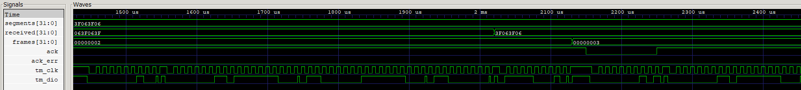

# Simulación del driver TM1637

## Qué se prueba

[tb_tm1637.v](tb_tm1637.v) verifica [tm1637_driver.v](../../src/tm1637_driver.v), que convierte cuatro bytes de segmentos en una comunicación serial con el display. Comprueba comandos, orden de bits, recepción de datos, captura coherente de los cuatro dígitos, reconocimiento ACK/NACK y recuperación después de errores.

Archivos: [testbench](tb_tm1637.v), [ejecutable](tb_tm1637.vvp) y [traza VCD](tm1637.vcd).

## Entradas, salidas y parámetros

| Puerto | Dirección y ancho | Función |
|---|---|---|
| `clk` | Entrada, 1 bit | Reloj de la lógica del driver |
| `segments` | Entrada, 32 bits | Cuatro códigos de segmentos; byte alto para el dígito izquierdo |
| `tm_clk` | Salida, 1 bit | Reloj de la comunicación serial con el TM1637 |
| `tm_dio` | Entrada/salida, 1 bit | Línea de datos compartida entre driver y receptor, usada también para ACK |
| `ack_err` | Salida, 1 bit | Indica que se detectó al menos un NACK en la trama evaluada |

En esta prueba `CLK_HZ=4.000.000`, `BIT_HZ=100.000` y `BRIGHT=7`. El testbench genera `clk` con período de **250 ns**. El divisor calcula `ceil(CLK_HZ/(4×BIT_HZ))=10`: produce un tick cada 2,5 µs y utiliza cuatro fases por bit, para un reloj serial de **100 kHz**.

`tm_clk` es el reloj del bus; se distingue del reloj `clk` que hace avanzar los registros internos. El valor por defecto del reloj del diseño de FPGA sigue siendo 125 MHz.

## Procesamiento de una trama

Al iniciar una trama el driver copia `segments` a `seg_q`. Los cuatro dígitos enviados se toman de esa copia, aunque la entrada cambie durante la transmisión. Se realizan estas transacciones:

| Transacción | Bytes enviados | Interpretación |
|---|---|---|
| Configuración | `40` | Escritura con incremento automático de dirección |
| Dirección y datos | `C0`, dígito izquierdo, dos intermedios y dígito derecho | Dirección inicial y cuatro códigos de segmentos |
| Control | `8F` | Display habilitado y brillo 7 |

Cada transacción comienza con START y termina con STOP. Cada byte se transmite con el **bit menos significativo primero**, seguido de un noveno pulso de reloj reservado para ACK. En total son siete bytes por trama.

La máquina de estados pasa por `S_IDLE`, `S_START`, `S_BIT`, `S_ACK` y `S_STOP`. `ph` indica la fase dentro de cada bit, `bit_i` su posición e `idx` el byte de la trama. DIO se conduce a cero o se libera en alta impedancia; el pull-up de la prueba establece el uno cuando ningún participante conduce la línea.

El driver acumula los NACK en `frame_error`, de modo que un ACK posterior no borre un error anterior de la misma trama. `ack_err` se actualiza al evaluar el ACK del último byte; durante una trama en curso puede conservar el diagnóstico anterior.

## Recepción dentro del testbench

El propio `tb_tm1637.v` observa START/STOP, reconstruye los bytes desde `tm_clk` y `tm_dio` y comprueba su orden y longitud. En el noveno pulso conduce DIO a cero si `ack=1` y lo libera si `ack=0`.

`ack` es un control de la prueba, no una entrada del driver. `received[31:0]` guarda los cuatro bytes recibidos al terminar la transacción de datos; `frames[31:0]` aumenta después de recibir también el comando de control. Por ello `received` puede actualizarse antes de que aumente `frames`.

La tarea `next_frame` espera un nuevo incremento de `frames` y añade 1 µs antes de comprobar el resultado. Un límite de 20 ms detiene la simulación si la recepción deja de avanzar.

## Las siete tramas de la prueba

| Trama | Estímulo o condición | Respuesta comprobada |
|---|---|---|
| 1 | `segments=063F063F`, ACK habilitado | Se recibe el patrón inicial y `ack_err=0` |
| 2 | Durante el envío del primer dígito se cambia la entrada a `3F063F06` | La trama todavía contiene los cuatro bytes del patrón anterior; no mezcla ambos valores |
| 3 | Se conserva la nueva entrada | La nueva trama entrega `3F063F06` |
| 4 | Se deshabilita ACK en el primer comando y se habilita para los siguientes | `ack_err=1`: el NACK temprano permanece registrado |
| 5 | Todos los ACK son correctos | `ack_err` vuelve a cero |
| 6 | ACK deshabilitado durante la trama | `ack_err=1`, condición de falta de respuesta del display |
| 7 | ACK habilitado nuevamente | Recuperación: patrón recibido correcto y `ack_err=0` |

Los bytes `06 3F 06 3F` dibujan **1010** y `3F 06 3F 06` dibujan **0101**. Son códigos preparados directamente por el testbench; esta prueba no llama al formateador para convertir un número.

Una trama ocupa aproximadamente **710 µs** con estos parámetros. La simulación completa termina en **4,971125 ms**. La falta de ACK se ensaya liberando la línea en los intervalos de reconocimiento; no se pretende reproducir el comportamiento eléctrico completo de un display desconectado.

## Señales disponibles para las capturas

| Señales de `tb_tm1637` | Qué se puede explicar |
|---|---|
| `segments`, `received` | Entrada actual frente al patrón realmente recibido; retardo de una trama cuando cambia a mitad del envío |
| `tm_clk`, `tm_dio` | Actividad serial, START/STOP y bits de cada byte |
| `ack`, `ack_err` | Inyección del NACK y diagnóstico de la trama |
| `frames` | Avance de las siete tramas completas |

Estas siete señales son las incluidas en el VCD. El reloj interno `clk` y los estados `state`, `ph`, `idx` y `bit_i` existen en el código, pero no se guardaron en esta traza. En una vista general interesan las siete tramas y los errores; en una ampliación del bus se pueden explicar los bits y el noveno pulso de reconocimiento.

## Captura y análisis

La captura muestra los patrones `segments/received`, el contador `frames`, las señales de reconocimiento `ack/ack_err` y las líneas seriales `tm_clk/tm_dio`. La ventana comprende aproximadamente **1,4–2,45 ms** y muestra la finalización de la tercera trama y el comienzo de la cuarta.

Al principio, la entrada `segments` ya vale `3F063F06`, mientras `received` conserva `063F063F`. Son patrones de segmentos para `0101` y `1010`, respectivamente. Cerca de **2,020 ms**, la recepción de los cuatro bytes de datos termina y `received` pasa al patrón nuevo. El contador `frames` aumenta de 2 a 3 alrededor de **2,130 ms**, después de recibir también el comando de control del display. La actualización del dato recibido y el cierre de la trama son eventos distintos.

Las líneas inferiores muestran actividad en el reloj serial y en DIO. Durante el comienzo de la cuarta trama, `ack` baja alrededor de **2,150 ms** y se restablece cerca de **2,250 ms**, introduciendo un NACK temprano. `ack_err` sigue en cero en esta captura porque el driver publica el diagnóstico al evaluar el último ACK de la trama, no inmediatamente al cambiar el control de la prueba.

### Alcance del intervalo

El diagnóstico de ese NACK aparece en **2,830 ms**, fuera de la ventana. Los cambios posteriores de `ack_err` ocurren cerca de **3,540 ms** (recuperación), **4,250 ms** (nueva falta de ACK) y **4,960 ms** (recuperación final). Por ello esta imagen muestra la inyección del error, pero no permite observar todavía su indicación ni las recuperaciones.

Para documentar las siete tramas conviene añadir una vista de **0–4,971125 ms**. Una ampliación de un byte y su noveno pulso permitiría distinguir los bits LSB primero y el reconocimiento. La escala actual es útil para comparar la entrada, la recepción y el contador de tramas.

La ejecución completa verificada termina con **siete tramas correctas según las condiciones del ensayo**, incluyendo la detección de los NACK intencionales y la recuperación posterior.

[Índice de simulaciones](../README.md) · [Resumen del proyecto](../../README.md).
