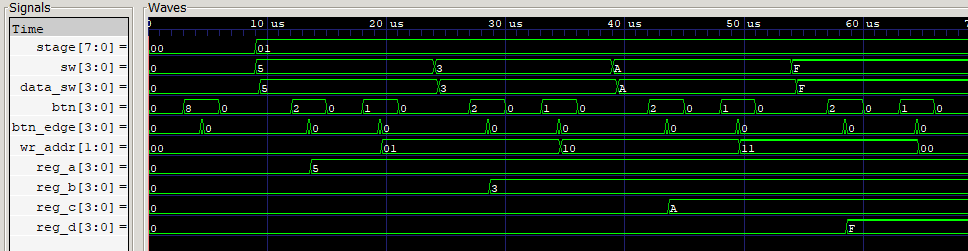
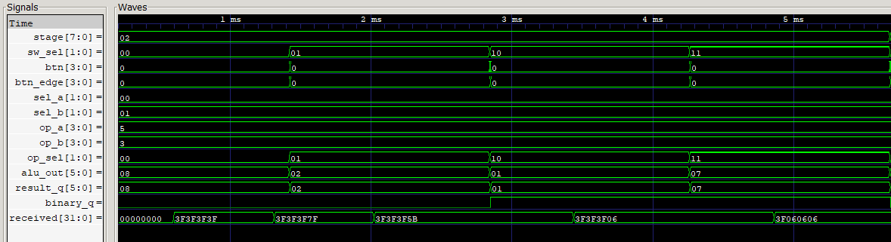
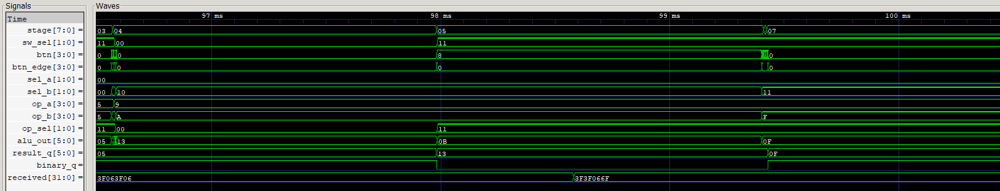

# Simulación del sistema completo

## Qué se prueba

[tb_top.v](tb_top.v) verifica [top.v](../../src/top.v) y los doce módulos que integra. La prueba relaciona las entradas que usaría el usuario con el almacenamiento en registros, la selección de operandos, la operación de la ALU y el contenido recibido por el display.

Archivos: [testbench](tb_top.v), [ejecutable](tb_top.vvp) y [traza VCD](top.vcd).

Se comprueba que el resultado y su formato cambien únicamente al ejecutar con BTN3. También se verifican todas las parejas A/B con las cuatro operaciones, la independencia entre datos y operación, los rebotes y las acciones simultáneas.

## Entradas y salidas de `top`

| Puerto | Dirección y ancho | Codificación o función |
|---|---|---|
| `clk` | Entrada, 1 bit | Reloj común del sistema |
| `sw` | Entrada, 4 bits | Dato sin signo, 0 a 15, para escribir en el banco |
| `btn` | Entrada, 4 bits | Un bit por botón: BTN0 destino, BTN1 escritura, BTN2 pareja, BTN3 ejecución; uno significa pulsado |
| `sw_sel` | Entrada, 2 bits | Operación externa: `00` suma, `01` resta, `10` AND, `11` OR |
| `led` | Salida, 4 bits | Dos bits del índice A seguidos por dos bits del índice B |
| `rgb_r`, `rgb_g`, `rgb_b` | Salidas, 1 bit cada una | Identifican el destino de escritura: R0 rojo, R1 verde, R2 azul y R3 blanco |
| `tm_clk` | Salida, 1 bit | Reloj de transmisión al TM1637 |
| `tm_dio` | Entrada/salida, 1 bit | Datos seriales y reconocimiento ACK del display |

Los switches de datos `sw` y los de operación `sw_sel` son buses distintos. Escribir un registro no ejecuta por sí mismo una operación; cambiar la operación tampoco escribe en los registros.

## Parámetros usados por esta simulación

| Parámetro | En `tb_top.v` | Valor por defecto del diseño de FPGA |
|---|---|---|
| `CLK_HZ` | 4.000.000 Hz, período 250 ns | 125.000.000 Hz, período 8 ns |
| `DEBOUNCE_CYCLES` | Cuatro muestras | 1.250.000 muestras |
| `TM_BIT_HZ` | 100.000 Hz | 100.000 Hz |

El reloj de prueba cambia cada 125 ns. Reducir las muestras de antirrebote permite ensayar muchas pulsaciones sin esperar 10 ms por transición. La prueba [independiente de antirrebote](../debouncer/README.md) sí utiliza el reloj y el umbral reales de la FPGA.

La tarea `settle` espera doce flancos descendentes, tiempo suficiente para las etapas de entrada con estos parámetros. `press(n)` mantiene `btn[n]` en uno durante esas doce muestras y luego en cero durante otras doce. El reloj, los parámetros y estas tareas pertenecen al testbench; los módulos del diseño mantienen sus valores por defecto.

## Recorrido de la información por los módulos

### Sincronización y controles

| Módulo | Entradas que recibe | Procesamiento | Salidas hacia el resto del sistema |
|---|---|---|---|
| [sync_inputs.v](../../src/sync_inputs.v), instancia de cuatro bits | `clk`, `sw[3:0]` | Dos etapas de flip-flops por bit | `data_sw[3:0]`, dato sincronizado para el banco |
| `sync_inputs`, instancia de dos bits | `clk`, `sw_sel[1:0]` | Sincronización separada de la operación | `op_sel[1:0]`, código usado por la ALU |
| [debouncer.v](../../src/debouncer.v), uno por botón | `clk`, cada bit de `btn` | Sincronización del botón y aceptación tras las muestras estables configuradas | `btn_db[3:0]`, niveles filtrados |
| [edge_detector.v](../../src/edge_detector.v), uno por botón | `clk`, cada bit de `btn_db` | Recuerda el nivel anterior y detecta la subida | `btn_edge[3:0]`, pulsos de un ciclo |
| [address.v](../../src/address.v) | `clk`, `btn_edge[0]` | Contador de dos bits, módulo cuatro | `wr_addr[1:0]`, destino de escritura |
| [comb_selector.v](../../src/comb_selector.v) | `clk`, `btn_edge[2]` | Contador de cuatro bits, dividido en dos índices | `sel_a[1:0]`, `sel_b[1:0]`, las 16 parejas ordenadas |

La sincronización desplaza las entradas a señales utilizadas dentro del reloj del sistema. La generación de un pulso por subida impide que un botón mantenido produzca varias escrituras, avances o ejecuciones.

### Datos, operación e indicadores

| Módulo | Entradas que recibe | Procesamiento | Salidas |
|---|---|---|---|
| [reg_bank.v](../../src/reg_bank.v) | Reloj, `data_sw`, `wr_addr`, `btn_edge[1]` y direcciones A/B | Escribe un registro de cuatro bits en el flanco habilitado; lee dos registros de forma combinacional | `op_a[3:0]`, `op_b[3:0]` |
| [alu.v](../../src/alu.v) | `op_a`, `op_b`, `op_sel` | Suma, resta, AND u OR; operandos sin signo y resultado de seis bits con signo | `alu_out[5:0]`, cálculo instantáneo |
| [result_register.v](../../src/result_register.v) | Reloj, `btn_edge[3]`, `alu_out`, `op_sel[1]` | Captura simultáneamente el valor y el modo al ejecutar | `result_q[5:0]` y `binary_q` |
| [indicators.v](../../src/indicators.v) | `wr_addr`, `sel_a`, `sel_b` | Decodifica el destino en RGB y concatena los índices A/B | RGB y `led[3:0]` |

El bit alto de la operación determina el formato: en suma/resta es cero y en AND/OR es uno. `result_register` guarda ese bit junto al valor. Por eso el display conserva tanto el resultado como su interpretación cuando se mueve el selector sin ejecutar.

### Visualización

| Módulo | Entradas que recibe | Procesamiento | Salidas |
|---|---|---|---|
| [display_tm1637.v](../../src/display_tm1637.v) | Reloj, `result_q`, `binary_q` | Agrupa el formateador y el driver | `tm_clk`, `tm_dio` y diagnóstico interno `ack_err` |
| [display_formatter.v](../../src/display_formatter.v) | Resultado de seis bits y modo | Convierte a cuatro caracteres decimales con signo o cuatro bits binarios | `segments[31:0]`, cuatro bytes de segmentos |
| [tm1637_driver.v](../../src/tm1637_driver.v) | Reloj y los cuatro bytes de segmentos | Captura una trama coherente y transmite comandos y datos con ACK | Actividad serial en `tm_clk/tm_dio` y diagnóstico de reconocimiento |

El display recibe `result_q`, no `alu_out`. La ALU puede responder a cambios de operandos u operación mientras el registro de resultado permanece constante. El refresco serial continúa transmitiendo el contenido almacenado.

## Verificación de lo recibido por el display

El testbench incluye la recepción del bus y genera ACK durante los intervalos correspondientes. Reconstruye los cuatro bytes en `received` y cuenta las tramas completas en `frames`.

La tarea `display_check` espera al menos dos tramas adicionales y compara `received` con los segmentos esperados para el último valor y modo ejecutados. Esa espera contempla que el driver pueda estar terminando una trama iniciada antes de la captura de BTN3. La comprobación observa la información transmitida por el bus, además de las señales internas del sistema.

`held` y `held_binary` son las referencias del último resultado y formato que deberían conservarse. La tarea `check_hold` compara ambas con `dut.result_q` y `dut.binary_q`. No son registros adicionales de la FPGA.

## Etapas de la simulación

La señal `stage[7:0]` identifica las siguientes fases:

| `stage` | Estímulos y procedimiento | Qué se comprueba |
|---|---|---|
| 0 | Arranque con datos, operación y botones en cero; ejecución inicial con BTN3 | Destino R0, pareja R0/R0, RGB rojo y resultado 0; la ALU responde correctamente desde sus entradas constantes |
| 1 | Se escriben R0=5, R1=3, R2=10 y R3=15, alternando BTN1 para escribir y BTN0 para avanzar | Carga de los cuatro registros y conservación del resultado mientras se escriben datos |
| 2 | Se selecciona A=R0/B=R1 y se ejecutan los cuatro códigos de operación | Resultados dirigidos, formato decimal/binario y contenido recibido por el display |
| 3 | Se recorren las 16 parejas; en cada pareja se ejecutan las cuatro operaciones | 64 combinaciones de pareja/operación, indicadores correctos y coincidencia con la referencia |
| 4 | Se reescribe R0=9 y se cambia operación y pareja sin ejecutar | El dato del banco y `alu_out` pueden cambiar sin alterar valor ni modo guardados |
| 5 | Se mantiene BTN3 pulsado y después se cambia la operación y la pareja | Solo la primera subida válida ejecuta; mantener el botón no repite la captura |
| 6 | Se aplica a cada botón un pulso corto de un ciclo | Los cambios rechazados por el filtro no alteran el último resultado |
| 7 | Se ejecuta OR y luego `sw` recorre los 16 datos posibles, sin nuevas escrituras ni ejecuciones | Cambiar los switches de datos no cambia el código externo de operación ni el resultado guardado |
| 8 | Se aplican dirección/escritura, escritura/ejecución y pareja/ejecución simultáneas | Cada módulo consume los valores previos al flanco compartido |

### Resultados dirigidos de la etapa 2

| Operación | A=5 (`0101`), B=3 (`0011`) | `binary_q` | Display | `received` esperado |
|---|---|---|---|---|
| `00`, suma | 8 | 0 | `0008` | `3F3F3F7F` |
| `01`, resta | 2 | 0 | `0002` | `3F3F3F5B` |
| `10`, AND | 1 | 1 | `0001` | `3F3F3F06` |
| `11`, OR | 7 | 1 | `0111` | `3F060606` |

Estos operandos corresponden a la simulación. Los videos físicos del proyecto emplean R0=15 y R1=1.

### Por qué se comprueban acciones simultáneas

Los registros del diseño se actualizan con asignaciones no bloqueantes en una subida común de reloj. Si varias habilitaciones coinciden, el dato utilizado es el que existía antes de esa subida:

- **BTN0 y BTN1:** se escribe R0=6 y la dirección pasa después a R1. El avance no redirige esa escritura a R1.
- **BTN1 y BTN3:** se escribe R0=4, pero el resultado capturado corresponde a los operandos previos. En el caso ensayado, OR sigue dando 15.
- **BTN2 y BTN3:** se captura la resta de la pareja anterior, 4−15=−11, y después la nueva pareja R1/R0 produce 3−4=−1 en `alu_out`. El resultado guardado conserva −11.

Estas comprobaciones explican por qué `alu_out` y `result_q` pueden ser distintos sin que exista un error. La interacción normal con el montaje se realiza pulsando un botón cada vez.

## Señales guardadas en `top.vcd`

| Grupo | Señales | Interpretación |
|---|---|---|
| Fase y entradas | `stage`, `sw`, `sw_sel`, `btn` | Identifica el ensayo y los cambios solicitados por el testbench |
| Entradas procesadas | `dut.data_sw`, `dut.op_sel`, `dut.btn_edge` | Datos y operación sincronizados, y acciones de un ciclo aceptadas |
| Selección | `dut.wr_addr`, `dut.sel_a`, `dut.sel_b` | Destino de escritura y direcciones A/B |
| Banco | `dut.u_regs.reg_a` a `reg_d` | Contenido de R0 a R3 |
| Operación y memoria | `dut.op_a`, `dut.op_b`, `dut.alu_out`, `dut.result_q`, `dut.binary_q` | Relaciona operandos, cálculo instantáneo y captura del último resultado |
| Indicadores | `led`, `rgb_r`, `rgb_g`, `rgb_b` | Código de pareja y destino seleccionado |
| Recepción | `received`, `frames` | Códigos de segmentos recibidos y avance de tramas |

Los buses `alu_out` y `result_q` se interpretan con signo. `received` es un patrón hexadecimal de cuatro bytes, no el resultado numérico de la operación. Los índices A/B son números de 0 a 3.

La traza selecciona estas señales y omite el reloj rápido, los contadores de antirrebote y las líneas `tm_clk/tm_dio`. Para explicar los bits del protocolo se utiliza la [traza específica del driver](../tm1637/README.md), donde sí se guardan las dos líneas del bus.

## Capturas y análisis

### Carga del banco: etapas 0 y 1

La captura muestra cómo los switches de datos y los botones controlan la dirección de escritura y el contenido de los cuatro registros. En las primeras decenas de microsegundos se pasa del arranque (`stage=00`) a la carga (`stage=01`).

Los switches `sw` toman **5, 3, A y F**, que corresponden a los valores decimales **5, 3, 10 y 15**. `data_sw` sigue esos cambios después de la sincronización. Las pulsaciones de escritura y avance hacen que `wr_addr` recorra `00`, `01`, `10` y `11`, mientras `reg_a`, `reg_b`, `reg_c` y `reg_d` almacenan cada dato y lo conservan durante las cargas siguientes.

`btn` aparece como un bus hexadecimal: `8` corresponde a BTN3 en el ensayo inicial, `2` a BTN1 para escribir y `1` a BTN0 para avanzar. `btn_edge` contiene pulsos más breves, pues cada acción aceptada dura un solo ciclo. La imagen permite comprobar que la selección, la escritura y el almacenamiento trabajan conjuntamente y que los cuatro registros terminan con sus valores de prueba.

### Cuatro operaciones dirigidas: etapa 2

En `stage=02`, `sel_a=00` y `sel_b=01` seleccionan **A=R0=5 y B=R1=3**. El selector externo y su versión sincronizada recorren `00`, `01`, `10` y `11`.

| Código observado | Operación | `alu_out` y `result_q` en hexadecimal | Significado | `binary_q` |
|---|---|---|---|---|
| `00` | Suma | `08` | 8, mostrado como `0008` | 0 |
| `01` | Resta | `02` | 2, mostrado como `0002` | 0 |
| `10` | AND | `01` | 1, mostrado como `0001` | 1 |
| `11` | OR | `07` | 7, mostrado como `0111` | 1 |

`received` pasa por los códigos `3F3F3F7F`, `3F3F3F5B`, `3F3F3F06` y `3F060606`, correspondientes a esas cuatro visualizaciones. Al comienzo conserva temporalmente un patrón anterior y después se actualiza al completarse la transmisión. La demora entre la captura del resultado y la recepción de segmentos es la latencia esperada del driver.

La ventana de varios milisegundos incluye las cuatro operaciones y sus actualizaciones de display. Los pulsos de `btn` y `btn_edge` quedan estrechos en esta escala; para medir su ancho haría falta una ampliación, pero la secuencia de resultados sí se distingue.

### Conservación del resultado y BTN3 mantenido: etapas 4, 5 y 7

La ventana de aproximadamente **96,5–100,4 ms** incluye el final del recorrido de parejas (`stage=03`), la retención tras escritura (`04`), el botón mantenido (`05`) y el comienzo de `07`. La etapa `06` también ocurre en ese intervalo, pero es demasiado breve para leerla claramente con esta escala.

En `stage=04`, R0 se reescribe y cambian la pareja y la operación. `alu_out` termina en `13` hexadecimal, equivalente a **19 decimal**, mientras `result_q` conserva `05` y el modo binario anterior. El cálculo combinacional cambia, pero el resultado almacenado sigue siendo el de la última ejecución.

Al comenzar `stage=05`, BTN3 se mantiene activo (`btn=8`). La primera pulsación aceptada guarda **19** y pone `binary_q=0`. Después se cambia la operación a OR: `alu_out` pasa a `0B`, equivalente a **11 decimal**, mientras `result_q` permanece en `13` y conserva el modo decimal. Esto muestra que mantener BTN3 no repite la ejecución.

Más adelante, al liberarlo y ejecutar otra vez en `stage=07`, `result_q` pasa a `0F` (**15 decimal**) y `binary_q` vuelve a uno. La fila `received` muestra la actualización previa a los segmentos decimales `3F3F066F`, que dibujan `0019`; la recepción del nuevo patrón binario ocurre después del extremo derecho de esta imagen.

### Alcance de las tres vistas

Las capturas de carga y de operaciones incluyen los eventos necesarios para explicar esas etapas. La de retención también permite distinguir el cálculo instantáneo del valor guardado, pero no debe usarse para afirmar que los rebotes o los eventos simultáneos se ven con detalle.

`stage=06` dura de **99,410 a 99,423 ms**: una ampliación de ese tramo permitiría mostrar los pulsos rechazados. `stage=08` empieza en **100,821125 ms**, fuera de la captura; una ventana desde allí hasta **102,241125 ms** mostraría las acciones simultáneas descritas en el testbench. Las **197 comprobaciones contabilizadas** corresponden a toda la ejecución, no solo a las tres ventanas presentadas.

[Índice de simulaciones](../README.md) · [Resumen del proyecto](../../README.md).
